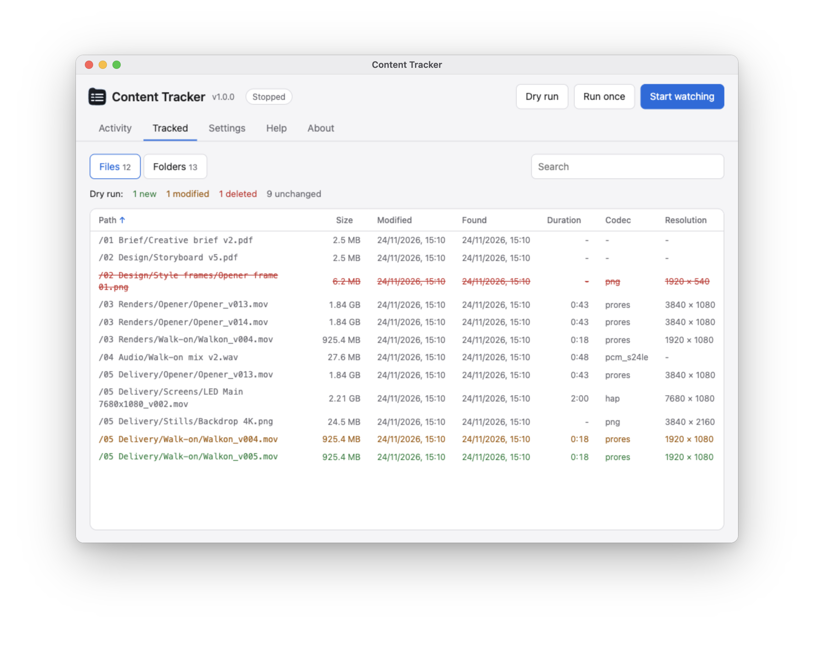

# Content Tracker


### Track files & folders to Airtable or Google Sheets
[](https://github.com/garethnunns/content-tracker/actions/workflows/ci.yml) [](https://github.com/garethnunns/content-tracker/releases/latest) [](https://github.com/garethnunns/content-tracker/releases) [](https://www.npmjs.com/package/@generativenoise/content-tracker) [](#app) [](LICENSE)

<br clear="left">



This project came about as a means to track video content on concert shows, but is written generically. It recursively scans folders, which can be mapped network drives or streamed cloud storage like Dropbox, Drive, LucidLink or Suite, and keeps a list of the files & folders on Airtable or Google Sheets.

There's a command line version and Mac, Windows & Linux apps, which do the same thing.

## Quick Start

### App

Download the latest version for Mac (Apple Silicon or Intel), Windows or Linux (an AppImage) from the [releases page](https://github.com/garethnunns/content-tracker/releases).

<!-- docs/help.md, the app's Help: change it there, then npm run readme -->

1. Under **Settings**, choose Airtable or Google Sheets, sign in, and choose the base or the spreadsheet. Then add the folders to track.
2. Try a **Dry run** to see what it will change, without affecting your existing data.
3. **Run once** updates the table, and **Start watching** keeps it up to date.

**Tracked** lists what was found in the last run, with its size, dates and media details - click a heading to sort by it, including when each was first found. After a dry run it's coloured by what it would do: green for new, orange for modified, red for deleted, grey for unchanged. Click anything to stop tracking it by its name, folder or extension.

You can close the window once it's configured and it will carry on in the menu bar (or the tray, on Windows), where you can run it once, start watching or open the settings. Tick **Open at Login** there to have it start with your computer.

More on [setting up Airtable](#airtable-setup) and [Google Sheets](#google-sheets-setup), the [fields it fills in](#tables), and [which folders and files are tracked](#configsettingsfilesrules).

<!-- end of docs/help.md -->

If you already have a config file from the command line, **Import settings** in **Settings** brings it across, and the token moves into your keychain. **Export settings** saves them as a config file for the command line or another computer, without your token or sign ins. If the app was watching when it was quit, it carries on when it's next opened.

When there's a newer version, the window and the menu say so: **Update and restart** downloads it from GitHub, checks it's what the release says it is, installs it and opens it again. On a Mac that works once it's in Applications; opened from anywhere else, it opens the new version for you to drag in.

_The app isn't signed by Apple or Microsoft yet. The first time you open it on a Mac, choose Done, then **Open Anyway** in System Settings > Privacy & Security. On Windows, choose More info, then Run anyway._

### Command line

```sh
npx @generativenoise/content-tracker
```

Then you just need to [edit the `config.json` file](#config-file) that was created where the command was executed and re-run with the [config command line option `tracker -c`](#config-option--c---config-path).

_Will require Node 22.12 or newer to be installed, if on Mac probably install with Homebrew:_
```sh
/bin/bash -c "$(curl -fsSL https://raw.githubusercontent.com/Homebrew/install/HEAD/install.sh)"
brew install node
```

It says when there's a newer version, and how to get it: `npx @generativenoise/content-tracker@latest`, or `npm install -g @generativenoise/content-tracker` if you installed it. Set `CONTENT_TRACKER_NO_UPDATE_CHECK=1` to stop it looking.

<details>
<summary><h2 id="airtable-setup">Airtable Setup</h2></summary>


Make a base, then see the section on [configuring the settings for Airtable](#configsettingsairtable) on how to link this to the script. **The tables and fields it needs are created the first time it runs**, or you can [duplicate this base](https://airtable.com/appPF3qIAsOaGMz9z/shr6Hx4YgXryKvy3e).

The easiest way in is to sign in with Airtable: **Sign in with Airtable** in the app, or `tracker login airtable` on the command line, which opens your browser. Airtable asks which bases it can use, and in the app **Choose** then lists them. The sign in is kept in your keychain by the app, and in a file only you can read by the command line (`~/.config/content-tracker/sign-ins.json`, or `%APPDATA%\content-tracker\sign-ins.json` on Windows). `tracker logout airtable` forgets it.

Or use a token, from the [Airtable Tokens page](https://airtable.com/create/tokens), with access to your base and these scopes:

- `data.records:read` & `data.records:write`
- `schema.bases:read` & `schema.bases:write` - for creating the tables. Without these it warns you and carries on with the tables you already have.

If you'd rather not keep the token in the config file, leave it blank and set `AIRTABLE_API_KEY` instead, which takes priority.

### Tables

Fields which are missing are added, and it won't touch any others, so you can add your own alongside them.

#### Folders Table

| Field       | Description                                 | Type
| ---         | ---                                         | ---
| `_path`     | Unix path to this folder in the project     | Single line text
| `_fullPath` | Will store the full path of the folder      | Single line text
| `_size`     | Size of the folder in bytes                 | Number - 0 decimal places
| `_sizeText` | The size as the Finder shows it, like `1.84 GB` | Single line text
| `_ctime`    | Creation time of the folder                 | Date - include time, **Use same time for all collaborators**
| `_mtime`    | Last modified time of the folder            | Date - include time, **Use same time for all collaborators**
| `_items`    | Number of items in the folder               | Number - 0 decimal places
| `_parent`   | Parent folder of this folder                | Link to record - this table

#### Files Table

Only this smaller table is used when the [mediaMetadata setting](#configsettingsfilesmediametadata) is disabled.

| Field       | Description                                 | Type
| ---         | ---                                         | ---
| `_path`     | Unix path to this file in the project       | Single line text
| `_fullPath` | Will store the full path of the file        | Single line text
| `_size`     | Size of the file in bytes                   | Number - 0 decimal places
| `_sizeText` | The size as the Finder shows it, like `1.84 GB` | Single line text
| `_ctime`    | Creation time of the file                   | Date - include time, **Use same time for all collaborators**
| `_mtime`    | Last modified time of the file              | Date - include time, **Use same time for all collaborators**
| `_parent`   | Parent folder of this file                  | Link to record - folders table

#### File Table with Metadata

All the fields of the [files table](#files-table) plus:

| Field               | Description                                 | Type
| ---                 | ---                                         | ---
| `_duration`         | Duration of the media                       | Number - 2 decimal places
| `_video`            | Whether the media has a video stream        | checkbox
| `_videoStill`       | Whether the file is a image                 | checkbox
| `_videoCodec`       | Video codec of the media                    | Single line text
| `_videoWidth`       | Width of the media                          | Number - 0 decimal places
| `_videoHeight`      | Height of the media                         | Number - 0 decimal places
| `_videoFormat`      | Pixel format of the media                   | Single line text
| `_videoAlpha`       | Whether the media has an alpha channel      | checkbox
| `_videoFPS`         | Frames Per Second of the video, 0 for stills| Number - 2 decimal places
| `_frames`           | Number of frames of video, 1 for stills     | Number - 0 decimal places
| `_framesExact`      | Whether `_frames` was counted, rather than worked out from the duration & frame rate | checkbox
| `_videoBitRate`     | Bit rate of the video (b)                   | Number - 0 decimal places
| `_colorPrimaries`   | Colour primaries the video is tagged with, like `bt709` or `bt2020`, blank if it isn't | Single line text
| `_colorTransfer`    | Transfer characteristics it's tagged with, like `bt709` or `smpte2084` (PQ), blank if it isn't | Single line text
| `_colorSpace`       | Colour space (matrix) it's tagged with, like `bt709` or `bt2020nc`, blank if it isn't | Single line text
| `_colorRange`       | Whether it's tagged as limited (`tv`) or full (`pc`) range, blank if it isn't | Single line text
| `_audio`            | Whether the media has a audio stream        | checkbox
| `_audioCodec`       | Audio codec of the media                    | Single line text
| `_audioSampleRate`  | Sample rate of the audio (KHz)              | Number - 0 decimal places
| `_audioChannels`    | Number of channels of audio                 | Number - 0 decimal places
| `_audioBitRate`     | Bit rate of the audio (b)                   | Number - 0 decimal places

### Field Notes

The fields are named like this so it's clear which fields are entered via the tracker, you can easily do other fields that reference these values, but do not edit the values in these columns or they will just get overwritten/deleted.

If all the records are being updated every time, it is likely because of a mismatch on the created/modified time - ensure the **Use same time for all collaborators** option is selected on these fields and you can try setting the timezone to match the computer which is running the script. _Tables created by the tracker are set up this way already._

</details>

<details>
<summary><h2 id="google-sheets-setup">Google Sheets Setup</h2></summary>


Sign in with Google: **Sign in with Google** in the app, or `tracker login google` on the command line, which opens your browser. Then choose the spreadsheet from your Google Drive - any spreadsheet you can edit: **Choose from Drive** in the app, or `tracker choose-spreadsheet`, which prints its ID for the config. **New spreadsheet** in the app makes one instead, named after the project. A sign in only opens the spreadsheets chosen or made this way, never the rest of your Drive, so one used with a version before 1.1 needs choosing once. The sign in is kept as Airtable's is, above, and `tracker logout google` forgets it.

### With a service account

For a computer no one signs in on, like a server running it from cron, use a service account instead: a robot Google account that you share the spreadsheet with.

1. In the [Google Cloud console](https://console.cloud.google.com/), create a project and enable the **Google Sheets API**.
2. Under **IAM & Admin > Service Accounts**, create a service account, then under its **Keys** tab add a JSON key. Keep this file somewhere safe - anyone with it can act as that account.
3. Make a spreadsheet and share it with the service account's email address (`...@...iam.gserviceaccount.com`) as an Editor.
4. Fill in the [Google Sheets settings](#configsettingsgooglesheets).

**The sheets and their header rows are created the first time it runs**, with the header row and `_path` frozen so they stay in view, and the columns fitted to what's in them. It has the same columns as the [Airtable tables](#tables), apart from `_parent` holding the parent folder's `_path`, as Sheets has no links.

You can add columns of your own, in any position, and sort or filter however you like: rows are matched by `_path` and only the tracker's own columns are written to. Removing a file removes its whole row, your columns included. Everything is written as plain values, so nothing a file is named can run as a formula.

_A spreadsheet can only hold 10 million cells, and it gets slow well before that - each file takes 7 cells, or 22 with media metadata. If you're tracking hundreds of thousands of files, use Airtable._

</details>

<details>
<summary><h2 id="command-line-options">Command Line Options</h2></summary>


Get the latest options by running `tracker -h` which will return something like:

```
Usage: tracker [options]

Track the content in your folders on Airtable or Google Sheets

Options:
  -V, --version          output the version number
  -c, --config <path>    config file path (if none specified template will be created)
  -d, --dry-run          will do everything apart from updating the tracker
  -l, --logging <level>  set the logging level
  -nc, --no-confirm      never ask for confirmation before making large changes
  -nd, --no-delete       never remove records
  -w, --wipe-cache       clear the metadata cache
  -h, --help             display help for command

Commands:
  login <service>        sign in with Google or Airtable, in your browser
  choose-spreadsheet     choose the spreadsheet from your Google Drive, in your browser
  logout <service>       forget a sign in
```

It's installed as both `tracker` and `content-tracker`. It exits with an error code if something went wrong, so a cron job can tell.

`tracker login google` or `tracker login airtable` signs in, in your browser ([Airtable](#airtable-setup), [Google Sheets](#google-sheets-setup)), and `tracker logout google` or `tracker logout airtable` forgets it. `tracker choose-spreadsheet` chooses the spreadsheet a Google sign in tracks in, from your Google Drive, and prints the ID to put in the config. Each prints the link too, in case the browser doesn't open (`BROWSER=none` stops it trying). The browser has to be on the same computer, as that's where the sign in comes back to - on one without, use a token or a service account.

### Config Option: -c, --config <path>

When you run `tracker` for the first time without a path option it will generate the `config.json` file which you will then need to update (it never overwrites one that's already there). Once updated run the command again with `tracker -c config.json`, for more info on the contents of the config file, check the [section on config files](#config-file).

### Dry-run Option: -d, --dry-run

Inherently, it's nice to know this isn't going to wreak havoc on your tracker, so if you run `tracker -c config.json -d` it will show you what it's going to do but stop short of modifying anything, including creating tables. It will still run on at the [frequency you specify](#configsettingsfilesfrequency). You will need to run with a [logging level](#logging-option--l---logging-level) of debug to see all the details.

### Logging Option: -l, --logging <level>

Specify one of the following levels of logging:

1. error
2. warn
3. info
4. http (default)
5. verbose
6. debug
7. silly

### No Confirm Option: -nc, --no-confirm

By default the script will stop and confirm before it removes more than 10% of the table (if you don't respond in under a minute, or there's no one to ask, as with cron, then it will assume not), but when run with `-nc` it will always delete the records. To never be asked, set [`removing.confirm`](#configsettingsremoving) to `false`.

### No Delete Option: -nd, --no-delete

This will still insert and update records, however will not remove them if they have been deleted in the local file system - handy if you are freeing up space on your local disk by deleting media but still want the reference in your tracker. To always keep them, set [`removing.enabled`](#configsettingsremoving) to `false`.

### Wipe Cache: -w, --wipe-cache

There's a cache of the metadata of files so they don't have to keep getting queried via ffprobe which is a tad computationally expensive, but if you need to rescan all files run with this option. Files will already be automatically scanned if they change size or the modified time changed. It's kept in your user cache folder, one per set of folders. In the app it's **Clear media metadata cache** in **Settings**.

</details>

<details>
<summary><h2 id="config-file">Config File</h2></summary>


Create the default config as [described above](#config-option--c---config-path), which will generate something like this:
```json
{
  "$schema": "https://unpkg.com/@generativenoise/content-tracker/core/config.schema.json",
  "settings": {
    "target": "airtable",
    "files": {
      "rootPath": "/Users/user/Documents/content",
      "dirs": [
        "/Users/user/Documents/content"
      ],
      "frequency": 30,
      "rules": {
        "dirs": {
          "includes": [],
          "excludes": []
        },
        "files": {
          "includes": [],
          "excludes": [
            ".DS_Store"
          ]
        }
      },
      "mediaMetadata": true,
      "limitToFirstFile": false,
      "trackFolders": true,
      "concurrency": 10
    },
    "removing": {
      "enabled": true,
      "confirm": true
    },
    "airtable": {
      "token": "",
      "base": "",
      "foldersTable": "Folders",
      "filesTable": "Files",
      "view": ""
    },
    "googleSheets": {
      "spreadsheetId": "",
      "credentials": "",
      "foldersSheet": "Folders",
      "filesSheet": "Files"
    }
  }
}
```

Only the section for your `target` needs filling in, and anything left out is what's shown above, so this is all it really needs:

```json
{
  "settings": {
    "files": { "dirs": ["/Users/user/Documents/content"] },
    "airtable": { "base": "app**************" }
  }
}
```

The `$schema` line lets editors like VS Code suggest and explain each setting as you type. If anything's wrong with the config, including a setting it doesn't know, it lists everything it found when you run it.

## config.settings

### config.settings.target

Where the files are tracked, either `airtable` or `googleSheets`, _it's `airtable` if you leave it out._

### config.settings.files

This section relates to all the local file scanning. The script in general builds up a list of all the files and folders and here you get a bit of control over that.

#### config.settings.files.rootPath

In an effort to make the script less dependent on exactly where the files are stored on your computer/where the folder is mounted, this string will be removed from the start of file paths.
```json
"rootPath": "/Volumes/Suite/Project"
```

#### config.settings.files.dirs

Array of directories to recursively search through, _e.g._
```json
"dirs": [ "/Volumes/Suite/Project/Item 1", "/Volumes/Suite/Project/Item 2" ]
```

If any of these or anything inside them can't be read, for example a drive has been unmounted, nothing is removed from the tracker that time, as everything on it would otherwise look like it's been deleted. If there's a folder it can never read, like `.Trashes` on a drive, add it to the [`dirs` excludes](#configsettingsfilesrules) (`".Trashes"`) and it won't hold things up.

#### config.settings.files.frequency

How often the directory is scanned (in seconds), _e.g. if you wanted to scan it every minute:_
```json
"frequency": 60
```

You can also set this to `0` and the script will only run once - this is intended if you want to automate this as part of a cron job.

#### config.settings.files.rules

Which folders and files are tracked: `dirs` decides which folders get a record, and `files` which files do. Each has `includes`, where anything has to match one of them to be tracked (empty tracks everything), and `excludes`, where anything that matches one isn't.

They're matched against the path as it's tracked, like `/05 Delivery/shot_v001.tif`, so the same rules work wherever the folders are and on Mac & Windows. It still looks through every folder whatever the rules say, so a file in a folder that isn't tracked can still be.

Each rule is a glob, or a regular expression for anything a glob can't do:

| Rule | Matches |
| --- | --- |
| `*.mov` | Any `.mov` file, in any folder - without a `/`, a glob matches the name anywhere, as in a `.gitignore` |
| `.DS_Store` | The Mac's `.DS_Store` files, wherever they are |
| `05 Delivery/**` | Everything in the `05 Delivery` folder at the top |
| `**/05 Delivery/**` | Everything in any `05 Delivery` folder |
| `**/renders/*.exr` | `.exr` files directly in any `renders` folder |
| `/_v\\d{3}\\.tif$/i` | A regular expression, written between `/`s: here `.tif` files ending in a version number like `_v012`, in any case. Its `\` need doubling in JSON, but a `/` inside it doesn't need escaping |

Globs are case sensitive, and a rule starting with `/` is always a regular expression, so a glob never does. Try them with [the dry run option](#dry-run-option--d---dry-run).

_For example, to only track the folders in any `05 Delivery` folder, and only the TIFFs with a version number or the first of a sequence:_

```json
"rules": {
  "dirs": {
    "includes": ["**/05 Delivery/**"],
    "excludes": []
  },
  "files": {
    "includes": ["/[_.]v\\d{2,3}\\.tif$/", "/[_.]0{4,5}\\.tif$/"],
    "excludes": []
  }
}
```

#### config.settings.files.mediaMetadata

Whether you want to get all the metadata for the media, which will scrape all the fields in the [files with metadata table](#file-table-with-metadata), _e.g._

```json
"mediaMetadata": true
```

#### config.settings.files.limitToFirstFile

This works in conjunction with the [file rules](#configsettingsfilesrules) but limits it to only the first file in each folder, with the intention of finding the first image in sequences, _e.g. this just gets the first TIFF file in the deliveries folder:_

```json
"rules": {
    "dirs": {
      "includes": [],
      "excludes": []
    },
    "files": {
      "includes": [
        "**/05_Delivery/**/*.tif"
      ],
      "excludes": []
    }
  },
  "mediaMetadata": true,
  "limitToFirstFile": true
```

#### config.settings.files.trackFolders

Whether the folders are tracked too, in [a table of their own](#folders-table) that each file links to with `_parent`. Turn it off to only track the files, with no folders table and no `_parent` field:

```json
"trackFolders": false
```

#### config.settings.files.concurrency

This limits the number of concurrent file operations across the whole scan, introduced to throttle the load on Suite. If you have a computer with enough RAM and the files are static then this value can be larger, however if it's a weak computer and the files are being streamed you might want to limit this to < 10, _e.g._

```json
"concurrency": 1
```

### config.settings.removing

What happens to the records of files and folders that have gone. `enabled` removes them, and turned off keeps them, like [`-nd`](#no-delete-option--nd---no-delete) every time. `confirm` asks before removing more than 10% of a table, and turned off doesn't, like [`-nc`](#no-confirm-option--nc---no-confirm) every time. Both are on if you leave them out, and the options can only turn them off for a run, _e.g. to keep everything that's been tracked:_

```json
"removing": {
  "enabled": false
}
```

Nothing is ever removed in a run where part of a folder couldn't be read, whatever these say.

### config.settings.airtable

Once you've [setup your Airtable](#airtable-setup), please configure the following settings:

#### config.settings.airtable.token

Your [personal access token](#airtable-setup), if you haven't signed in. You can leave this blank and set `AIRTABLE_API_KEY` instead, and either is used over a sign in. If it's in the file, make sure only you can read it (`chmod 600 config.json`) and don't commit it - the script warns you if others can.

#### config.settings.airtable.base

You'll need to go to the [API page for your base](https://airtable.com/developers/web/api/introduction) and get the base ID and enter this here, _e.g._

```json
"base": "app**************"
```

#### config.settings.airtable.foldersTable / filesTable

These can be table names or IDs. With a name, the table is created if it doesn't exist. On [the same page as the base ID](https://airtable.com/developers/web/api/introduction) you can get the IDs for the tables, then if the table names get updated later it won't affect the script, _e.g._

```json
"foldersTable": "tbl**************",
"filesTable": "tbl**************"
```

#### config.settings.airtable.view

This is the view the script compares the local file list against - e.g. you could technically store other items in the table and filter them out in this view; you could have multiple scripts all writing into the same table and filter them out per view _(this might be better achieved by writing to multiple tables)._

Leave it blank to use the whole table. Airtable can't create views for us, so if you set this you'll need to add the view yourself. It stops if the view isn't there, rather than comparing against the whole table and removing whatever it doesn't recognise.

```json
"view": "API"
```

### config.settings.googleSheets

Once you've [setup your spreadsheet](#google-sheets-setup), please configure the following settings:

#### config.settings.googleSheets.spreadsheetId

The spreadsheet's link, or the long part of it between `/d/` and `/edit`. Signed in with Google, choose it with `tracker choose-spreadsheet`, which prints it.

```json
"spreadsheetId": "https://docs.google.com/spreadsheets/d/1aBcD**************************************/edit"
```

#### config.settings.googleSheets.credentials

The path to the [service account's](#with-a-service-account) JSON key, if you're using one rather than signing in. You can leave this blank and set `GOOGLE_APPLICATION_CREDENTIALS` instead, and either is used over a sign in.

```json
"credentials": "/Users/user/.keys/content-tracker.json"
```

#### config.settings.googleSheets.foldersSheet / filesSheet

The names of the tabs to use, which are created if they don't exist.

```json
"foldersSheet": "Folders",
"filesSheet": "Files"
```

</details>

<details>
<summary><h2 id="development">Development</h2></summary>


Clone the repo and run it locally like so:

```sh
git clone https://github.com/garethnunns/content-tracker.git
cd content-tracker
npm install
npm link
tracker
```

_You can always `npm unlink` this later._

How it fits together, the commands, building the app and the rules for changing it are all in [CONTRIBUTING.md](CONTRIBUTING.md).

### Releasing

Publishing a GitHub release, tagged `v<version>`, publishes to npm and attaches the Mac, Windows & Linux apps. Each version's release notes are `docs/release-notes/<version>.md`, which become the GitHub release's description, and the release won't publish without them. npm takes it from this repository's release workflow with no token, by [trusted publishing](https://docs.npmjs.com/trusted-publishers), set up in the package's settings on npm. The release needs a `GOOGLE_CLIENT_SECRET` secret with the Google client secret.

Dependabot opens a pull request each week for packages with newer versions, and minor and patch updates merge by themselves once the checks pass. Major updates, and the workflows' actions, wait for someone to merge them.

Very welcome to pull requests! [CONTRIBUTING.md](CONTRIBUTING.md) has how to set up, the rules that keep people's tables safe, and what to check first.

</details>

<details>
<summary><h2 id="licence">Licence</h2></summary>


Copyright (C) 2024-2026 Generative Noise

This program is free software: you can redistribute it and/or modify it under the terms of the GNU General Public License as published by the Free Software Foundation, either version 3 of the License, or (at your option) any later version. It is distributed in the hope that it will be useful, but WITHOUT ANY WARRANTY; without even the implied warranty of MERCHANTABILITY or FITNESS FOR A PARTICULAR PURPOSE. See [LICENSE](LICENSE) for the details.

Content Tracker includes [FFmpeg](https://ffmpeg.org)'s ffprobe 9.1, under the GPL 3, in the `@generativenoise/ffprobe-<platform>-<arch>` packages: unchanged builds by [Martin Riedl](https://ffmpeg.martin-riedl.de) for Mac and Linux and [Gyan Doshi](https://www.gyan.dev/ffmpeg/builds/) for Windows, each pinned by its sha256 in `scripts/ffprobe-packages.mjs`. FFmpeg's source is at [ffmpeg.org](https://ffmpeg.org/releases/ffmpeg-9.1.tar.xz).

</details>
